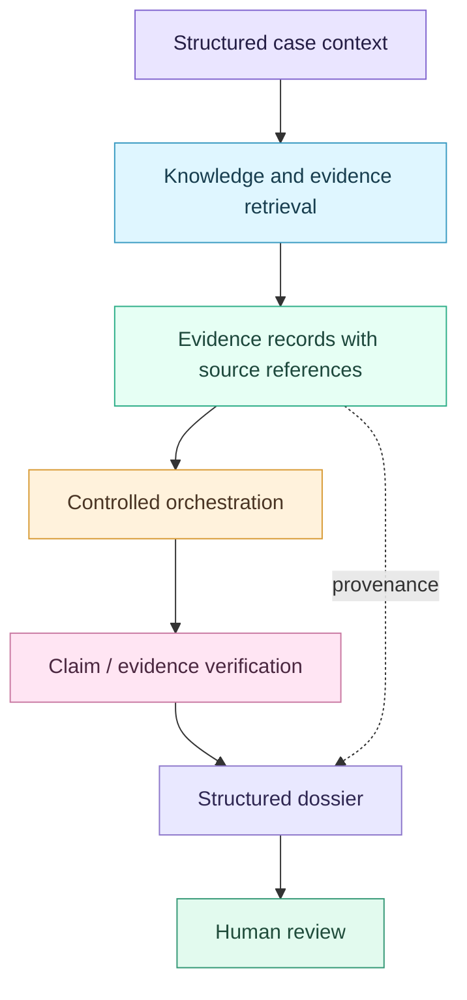

# 🧬 MTB GraphRAG — architecture at a glance

**Research prototype for evidence-grounded support in Molecular Tumor Boards.** This is a systems-research project, not a diagnostic or therapeutic application.

## Problem and design

Molecular Tumor Boards need to connect clinical context and molecular alterations to inspectable evidence. A fluent LLM answer is insufficient unless its factual claims can be traced to appropriate sources.

The implementation explores an architecture that separates **retrieval, orchestration, evidence provenance, verification and presentation**.

*Conceptual view: the detailed implementation, data boundaries and experimental variants are documented in [the application README](../mtb-graphrag/README.md). The diagram is not an assertion that every path is validated end to end.*

## Main contributions explored

| Component | Purpose |
| --- | --- |
| Structured context | Keep case characteristics explicit, avoiding silent assumption filling |
| Knowledge/evidence retrieval | Associate retrieved material with the relevant molecular and clinical context |
| Provenance | Preserve source identifiers and the path from evidence to statements |
| Controlled orchestration | Make tool usage and execution steps more inspectable than unconstrained generation |
| Claim verification | Distinguish supported, uncertain and unsupported information |
| Dossier | Present evidence for review rather than autonomous decision-making |

## How to inspect the code

- [Backend pipeline](../mtb-graphrag/backend/pipeline/) — processing and orchestration components
- [API](../mtb-graphrag/backend/api/) — application integration
- [Evaluation](../mtb-graphrag/backend/evaluation/) — research/evaluation utilities
- [Tests](../mtb-graphrag/backend/tests/) — focused code tests
- [Application setup](../mtb-graphrag/README.md) — environment and service requirements

## Reproducibility and limitations

A reproducible comparison must identify the dataset/knowledge-base snapshot, code revision, retrieval configuration, model settings and evaluation protocol. Do not compare numbers obtained with incompatible inputs or experimental setups.

- Not every experiment in the repository uses the same runtime or dataset snapshot.
- External sources and LLM endpoints can change or be unavailable.
- Presence of tests or evaluation scripts does **not** mean they were executed successfully in a fresh environment.
- No clinical safety or deployment-readiness claims are made.

## Safety

This software is for research and educational purposes only. It must not be used to select treatment, diagnose patients or replace a qualified clinician.
