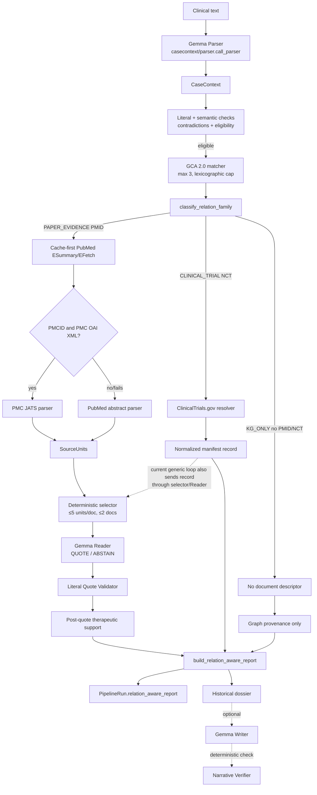
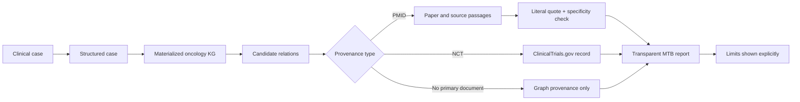

# Complete architecture audit — relation-aware MTB pipeline

> **Historical pre-consolidation audit.** This document records the state at
> `dd010056ae348e42e66a6f0098c9eeb26890d6b2` and is retained for traceability.
> Its findings were the input to the final consolidation. The current canonical
> description is [`architecture_final.md`](architecture_final.md).

## Scope, method, and source of truth

- **Canonical architecture commit:** `dd010056ae348e42e66a6f0098c9eeb26890d6b2` — `relation-aware core: expose canonical MTB report from runtime`.
- **Audit head:** `273c6ca53a1515157d75c9b96d7c501768a5551f`.
- `git show -s` confirms the canonical SHA and subject. `git diff --name-only dd010…HEAD -- backend/research_pipeline` is empty: **no file under `backend/research_pipeline/**` changed after the canonical architecture commit**. Later commits contain only evaluation/documentation artifacts.
- Method: static read-only inspection of the canonical code and the frozen GCA 2.0 JSONL. No model run, API call, cache mutation, evaluation, or source fetch was performed.

The code, rather than comments or historical documents, is the source of truth. Several comments/document strings are demonstrably stale and are reported below.

## Executive finding

The implemented system is a research runtime that takes free clinical text, extracts a constrained `CaseContext`, retrieves up to three **materialized Graph Candidate Assertions (GCAs)**, and builds a deterministic `relation_aware_report`. It distinguishes three provenance families:

1. **`PAPER_EVIDENCE`** — a GCA with a PMID; it can be grounded in a PubMed/PMC document, parsed into SourceUnits, quoted by the Reader, literally validated, and compared with the GCA.
2. **`CLINICAL_TRIAL`** — a GCA with an NCT identifier; it can resolve a ClinicalTrials.gov record and is represented as an association, explicitly not as efficacy evidence.
3. **`KG_ONLY`** — a GCA without PMID/NCT; it remains a graph assertion with graph lineage and an explicit absence of usable document provenance.

This is a sound conceptual split, and the deterministic report model preserves it. However, the canonical runtime is **not architecturally consistent yet** with the claimed three-branch execution:

- no trial GCA in the actual v2 corpus can pass the canonical retrieval predicates; and
- if a trial is injected past retrieval, the generic paper-selection/Reader path processes its trial record before the report projection, contrary to the intended “trial without Reader/quote” design.

These are P0 findings. The architecture should not be presented as a fully working three-branch runtime until they are addressed or the presentation is narrowed to the paths actually reachable.

---

## 1. Runtime entry point and returned object

| Item | Implemented location | Actual behavior |
|---|---|---|
| API entry | `backend/api/research_routes.py:136`, `create_run()` | `POST /runs` accepts `clinical_text` plus a case ID/demo key, checks LLM/cache availability, then calls `RunStore.start()`. The research route is feature-gated. |
| Runtime entry | `backend/research_pipeline/run_store.py:144`, `RunStore.start()` | Creates a background thread. |
| Coordinator | `run_store.py:171`, `RunStore._execute()` | Opens canonical `DocumentRuntime`, installs live Parser/Reader/validator/narrator adapters, then calls `orchestrator.run_case()`. |
| Orchestrator | `backend/research_pipeline/orchestrator.py:291`, `run_case()` | Coordinates stages 1–15 and creates both reports. |
| Final type | `backend/research_pipeline/contracts.py:367`, `PipelineRun` | `PipelineRun.to_dict()` includes stages, historical dossier ID and `relation_aware_report`. |

`PipelineRun` is the actual final return type. The new report is returned under `relation_aware_report`; the historical dossier remains a separate stage artifact.

## 2. Actual end-to-end pipeline

| Stage | Code | Input → output | Deterministic / LLM | Mandatory in a successful canonical run |
|---|---|---|---|---|
| 1. Input | `orchestrator.py`, `run_case()` | clinical text → run ledger event | Deterministic | Yes |
| 2. Case parser | `casecontext/parser.py:182`, `call_parser()` through `live_providers.py:60` | text → raw parser tool output + adapted `CaseContext` | LLM | Yes |
| 3. Literal match | `casecontext/match_verifier.py:71` | parser fields + text → field-level literal checks | Deterministic | Yes |
| 3b. Eligibility chain | `casecontext/pipeline.py:80`, `run()` | context + text → typed mentions, semantic checks, contradictions, eligibility | Deterministic | Yes; may stop the run |
| 4. Retrieval plan | `orchestrator.py` stage 4 | eligible context → fixed retrieval projection | Deterministic | Yes after eligibility |
| 5. GCA retrieval | `retrieval/kg_retrieval.py:178`, `retrieve()` | `CaseContext` → at most 3 associations | Deterministic | Yes after eligibility |
| 6. Document resolution | `documents/live_resolution.py:486`, `DocumentRuntime.resolve()` | provenance descriptors → resolved documents/cache records | Deterministic, cache-first external fetch on miss | Only document-bearing associations cause actual resolution |
| 7. SourceUnits | `live_resolution.py:386`, `load_source_units()` | resolved document → parsed SourceUnits | Deterministic | Only resolved documents cause parsing |
| 8. SourceUnit selection | `retrieval/live_sourceunit_selection.py:15` | candidate + document units → selected units | Deterministic | Called for every association; meaningful for documents |
| 9. Paper Reader | `enrichment/enricher_v2.py:31` through `live_providers.py:70` | bounded SourceUnits → `QUOTE` or `ABSTAIN` | LLM | Only if a selected document is present |
| 10. Quote validation | `enrichment/validator_v2.py:97` | Reader output + units → accepted/rejected/abstained outcome | Deterministic | Only after a Reader call |
| 11. Legacy gates | `determinism/gates.py:201` | validated enrichment → historical status/bucket | Deterministic | Evaluated for every retrieved association |
| 12. Status | `orchestrator.py` stage 12 | evaluations → historical candidate status | Deterministic | Yes after retrieval |
| 13. Reports | `dossier/builder.py:91,196` | associations/results → historical dossier + relation-aware report | Deterministic | Yes if stages 1–12 complete |
| 14. Narration | `narrative/narrator.py:97` | historical dossier → narrative | LLM, optional | No for the relation-aware report |
| 15. Narrative verifier | `narrative/verifier.py:293` | historical dossier+narrative → pass/fallback | Deterministic | Presentation-only; does not change the new report |

## 3. Case parser and post-parser controls

### Parser

- **File/function:** `backend/research_pipeline/casecontext/parser.py:182`, `call_parser()`.
- **Prompt/schema:** `casecontext/prompt.py`; version `casecontext-parser-prompt/2.0`, forced tool `submit_case_context`.
- **Configured LLM:** the shared transport resolves `https://ollama.com/v1/chat/completions` by default and model tag `gemma4:cloud`; both are environment-overridable (`llm_config.py:75–129`). Payload settings are temperature 0, top-p 1, fixed seed/run index, and forced tool choice (`enrichment/transport.py:49`).
- **Tool fields:** `disease`, `biomarkers[]` (`gene`, `alteration`), `previous_interventions[]`, `target_intervention`, `query_intent`. Each extracted value contains a raw literal value and literal quote, or null/empty list.
- **Adapted `CaseContext`:** `case_id`, schema version, disease, biomarkers with normalized value and source spans, previous interventions, target intervention, query intent, original clinical question, and empty `uncertainties` (`parser.py:112`).

The parser is not allowed to make a clinical recommendation. It may retry once only when forced-tool delivery was ignored; infrastructure retry is separate and limited to one retry for timeout/connection/5xx errors.

### Active deterministic controls after parsing

`casecontext/pipeline.py:80` runs:

- literal span matching (`match_verifier.py`); essential disease/biomarker mismatches veto retrieval;
- typed mention construction and semantic verification;
- control-instruction span detection;
- contradiction detection;
- the pre-retrieval eligibility gate (`eligibility/gate.py:93`).

The eligibility gate can stop empty, out-of-scope, non-actionable, insufficient, incomplete, contradictory, adversarial/control, and ambiguous inputs. It is active legacy routing/eligibility code—not removed by the relation-aware slices.

## 4. GCA / Knowledge Graph layer

### What is queried

The runtime does **not** query a live Neo4j/graph service. `data_access.py:52–77` reads and SHA-256 validates the frozen materialized file:

`benchmarks/mtb_evidence/document_grounded_claims/graph_candidate_repository/2.0/candidates.jsonl`

The actual corpus contains **46,864 GCA records**. A GCA is a graph-derived candidate assertion with graph path/edge/node lineage. The graph proposes assertions and sometimes carries a document identifier; it does not by itself decide therapy or establish final document support.

### Six materialization rules in the active v2 corpus

| Rule / count | Predicate(s) | Source graph path | Principal fields/provenance | Identifier class |
|---|---|---|---|---|
| `gca/2.0/evidence-statement` — 4,860 | `has_evidence_statement` | molecular profile → evidence; linked variant/gene/disease/publication | biomarkers, disease, evidence scope, source evidence properties, node/edge/path IDs | PMID |
| `gca/2.0/evidence-to-drug` — 3,370 | sensitivity 2,184; resistance 1,184; `evidence_association` 2 | evidence path plus evidence → drug edge | disease, biomarker/variant, intervention, direction, evidence properties, node/edge/path IDs | PMID |
| `gca/2.0/trial-drug` — 7,381 | `trial_association` | `edges_trial_drug.csv` | NCT trial node, drug object/intervention, edge/path IDs | NCT |
| `gca/2.0/trial-gene` — 5,501 | `trial_association` | `edges_trial_gene.csv` | NCT trial node, gene object/biomarker, edge/path IDs | NCT |
| `gca/2.0/gene-drug-interaction` — 25,589 | `gene_drug_interaction` | `edge_interacts_with.csv` | gene, drug, source database in interaction properties, graph IDs | none |
| `gca/2.0/companion-diagnostic` — 163 | `has_companion_diagnostic` | companion diagnostic/device → gene path | gene, diagnostic/device, graph IDs | none |

The six source rules are independently documented in `evaluation/rq1/kg_source.py:54–67`; the active runtime consumes v2, not `gca_v3/`.

### Family totals derived from the actual identifiers

| Family | Rule composition | Count |
|---|---:|---:|
| `PAPER_EVIDENCE` | evidence-statement + evidence-to-drug | 8,230 |
| `CLINICAL_TRIAL` | trial-drug + trial-gene | 12,882 |
| `KG_ONLY` | gene-drug-interaction + companion-diagnostic | 25,752 |

GCA fields actively preserved include `candidate_id`, subject/predicate/object, disease, biomarkers, interventions, direction, `document_identifiers`, `node_ids`, `edge_ids`, `graph_path`, `materialization_rule_id`, and `source_properties`. There is no live graph traversal in the canonical runtime.

## 5. Retrieval

### Implemented rules

`retrieval/kg_retrieval.py:134`, `_match_candidate()` applies:

| Clinical field | Implemented rule |
|---|---|
| Disease | Normalized case disease must be substring-compatible with a candidate disease label. Exception: a `KG_ONLY` candidate with no disease is allowed. |
| Biomarker | At least one parsed gene/raw/normalized biomarker term must substring/share a meaningful token with a candidate biomarker label. |
| Intervention | Only for `THERAPY_EVALUATION`, the target intervention must match a candidate intervention label. |
| Intent | `THERAPY_DISCOVERY` skips intervention matching. |
| Cap | Matched candidates are candidate-ID sorted and truncated to `MAX_ASSOCIATIONS_PER_CASE = 3` (`kg_retrieval.py:30,224`). |

There is no relevance score after matching: “ranking” is stable lexicographic candidate ID order followed by the cap. `MAX_DOCUMENTS_PER_ASSOCIATION=2` is applied later by the SourceUnit-selection component.

### Document-identifier admission

The code in `_retrieve()` at lines 204–212 calls `classify_relation_family(candidate)` and returns `True` for every live candidate. Therefore the actual code does **not** require `document_identifiers` for admission. This is confirmed by Slice 1 tests. Comments/docstrings in the same file still say the opposite; they are stale.

| Family | Can survive identifier admission? | Can survive the full clinical matcher? |
|---|---|---|
| PAPER | Yes | Conditionally: disease+biomarker, plus drug for therapy evaluation |
| KG_ONLY | Yes | Yes for relevant gene-drug records; companion diagnostics require discovery intent because they have no intervention |
| TRIAL | Yes | **No for the current v2 corpus**; see P0-1 below |

### P0-1: trial path is unreachable from canonical retrieval

Static inventory of all 12,882 trial GCAs shows:

- all **12,882** have no `disease`;
- all **7,381 trial-drug** GCAs have an intervention but no biomarker;
- all **5,501 trial-gene** GCAs have a biomarker but no intervention.

The full matcher requires disease and a biomarker for every non-KG-only candidate. For therapy evaluation it also requires an intervention. It follows that neither trial subtype can satisfy the canonical matcher. The Slice 4 and multi-family tests demonstrate the downstream projection by injecting a trial association; they do not prove retrieval through the normal live `retrieve()` path.

## 6. Relation-family classifier

`backend/research_pipeline/retrieval/relation_family.py:13`, `classify_relation_family(candidate)` is deterministic and deliberately ignores source labels:

| Output | Condition | Meaning |
|---|---|---|
| `PAPER_EVIDENCE` | any non-empty `pmid` in `document_identifiers` | Candidate has publication provenance usable by the paper branch. |
| `CLINICAL_TRIAL` | any non-empty `nct`, with no PMID | Candidate has ClinicalTrials.gov provenance. |
| `KG_ONLY` | identifier field absent, null, or has neither PMID nor NCT | Candidate has no usable primary document provenance in the current GCA record. |
| Error | PMID and NCT both present | `ValueError`: mixed provenance has no defined family. |

`source_type` (for example PubMed, ASCO, ASH, OncoKB) is not used as a proxy for document provenance.

## 7. PAPER_EVIDENCE path

### A. Candidate to document

1. `kg_retrieval._live_provenance_bundles()` converts the candidate’s identifier to a `live:<candidate>:pmid:<id>` descriptor.
2. `DocumentRuntime.open()` (`live_resolution.py:441`) opens an `AuthorizedDocumentCache` in cache-first/live-on-miss mode.
3. `resolve_live_documents()` calls `AuthorizedDocumentCache.resolve_live_identifier()`.
4. `resolve_pmid()` (`authorized_cache.py:314`) calls NCBI ESummary for metadata and EFetch XML for abstract/full identifier fields.
5. If EFetch yields a PMCID, `resolve_live_identifier()` calls `resolve_pmc()` (`authorized_cache.py:375`) via PMC OAI-PMH `GetRecord&metadataPrefix=pmc`.
6. If PMC XML resolves, it becomes the canonical record. Otherwise the PubMed abstract record remains, with `degradation_reason=PMC_RESOLUTION_FAILED`.

The resulting state is `PMC_XML_AVAILABLE`, `ABSTRACT_AVAILABLE`, or an explicit unavailable/failure state; the runtime does not seek alternative literature.

### B. Document to SourceUnits

`AuthorizedDocumentCache.source_units_for_record()` (`authorized_cache.py:509`) uses:

- `PubMedAbstractParser` for an abstract;
- `JatsXmlParser` for PMC XML/JATS full text;
- `PdfDocumentParser` only for explicitly supplied local PDFs.

`DocumentRuntime.load_units()` re-parses every resolved document and keeps complete text only server-side in `SourceUnitBundle.units_by_id`; stage/API previews contain locators, hashes, type, and a truncated preview (`live_resolution.py:325–421`).

### C. SourceUnit selection and Reader

`retrieval/live_sourceunit_selection.py:15`, `select_live_papers_for_association()` sorts full text before abstract, invokes the deterministic selector with top-k 5, and returns at most two documents. The Reader receives only selected SourceUnits, never the full article (`live_providers.py:70–94`).

`enrichment/enricher_v2.py:31`, `call_enricher_v2()` uses prompt `paper-context-enricher-prompt/2.0`. The forced tool can return only:

- `decision`: `QUOTE` or `ABSTAIN`;
- `source_unit_id`;
- literal `author_claim_quote`;
- short `author_context_summary`;
- `abstention_reason`.

It is explicitly forbidden to classify support, direction or efficacy.

### D. Quote validation and support

`enrichment/validator_v2.py:97`, `validate_enrichment_v2()` rejects invalid transport, unknown/unselected SourceUnits, nonliteral/non-contiguous quotes, candidate/case echo, absent requested drug, unsupported/recommendatory summaries, and inconsistent abstentions. A validated quote is literal text from the selected frozen/live SourceUnit.

`enrichment/post_quote_support.py:132`, `assess_candidate_support()` runs only after an accepted quote. It examines quote plus the source-unit text and returns field states:

- disease: `CONFIRMED` or `UNKNOWN`;
- gene: `CONFIRMED`, `NOT_CONFIRMED`, or `UNKNOWN`;
- alteration: `CONFIRMED`, `NOT_CONFIRMED`, or `NOT_APPLICABLE`;
- drug: `CONFIRMED` or `UNKNOWN`;
- direction: `CONFIRMED`, `OPPOSITE`, or `UNKNOWN`.

Its actual overall vocabulary is **not** `FULL_SUPPORT/NO_SUPPORT`: it returns `STRONG_SUPPORT`, `PARTIAL_SUPPORT`, `CONTEXT_ONLY`, `CONTRADICTORY`, or `UNVERIFIABLE`.

Rules (`post_quote_support.py:118`):

- `CONTRADICTORY`: opposite direction + confirmed gene/drug + confirmed or N/A alteration;
- `UNVERIFIABLE`: drug unknown;
- `STRONG_SUPPORT`: confirmed gene and direction, with confirmed or N/A alteration;
- `PARTIAL_SUPPORT`: confirmed gene/direction but alteration not confirmed;
- otherwise `CONTEXT_ONLY`.

Disease is computed but is **not required** by the final `STRONG_SUPPORT` condition. Evidence type is **not checked** by this support checker.

Only an accepted quote with `STRONG_SUPPORT` reaches the historical deterministic gate (`orchestrator.py:81`). `PARTIAL_SUPPORT` remains visible in the relation-aware report but cannot promote an historical candidate.

### CASE-1 as an example of the general rule

The offline Slice 3 test (`tests/test_case1_relation_aware_report.py`) uses real candidate `GCA-008ae3aad1a64c118318ef79`, PMID `19223544`, and a literal SourceUnit quote about KRAS-mutant mCRC resistance to panitumumab/cetuximab. The generic rules derive disease/gene/drug/direction as confirmed, alteration G12D as not confirmed, and thus `PARTIAL_SUPPORT`. The test does not hard-code an exception in production code; it exercises the general alteration-specificity rule.

### P1-1: positive-direction support cannot be confirmed by the live v2 contract

The v2 Reader schema intentionally has no `evidence_kind` field (`enrichment/prompt_v2.py`). `_direction_status()` in `post_quote_support.py:95` can use text only for explicit **resistance** constructions; positive sensitivity/response directions require `evidence_kind=RESPONSE|BENEFIT`, which the v2 Reader cannot produce. Consequently, in a live v2 run a sensitivity/response candidate cannot obtain `direction=CONFIRMED` through this checker. The older deterministic gate can use GCA source polarity, but `_accepted_for_gates()` still requires `STRONG_SUPPORT`, which the support checker cannot derive without confirmed direction. This is a serious semantic mismatch between the intended generic paper branch and its active checker.

## 8. CLINICAL_TRIAL path

### Implemented resolver/projection

For an NCT descriptor, `AuthorizedDocumentCache.resolve_nct()` (`authorized_cache.py:405`) calls:

`https://clinicaltrials.gov/api/v2/studies/{NCT}`

It persists raw JSON and normalizes: brief title, brief/detailed description, conditions, interventions, study type, phases, recruitment/overall status, and last update. `build_relation_aware_report()` maps available record fields to `nct_id`, title, status, phase, conditions, interventions, biomarker gene, source, provenance status, and `eligibility_status=NOT_EVALUATED` by default.

Every trial entry also has:

`evidence_interpretation = TRIAL_ASSOCIATION_NOT_EFFICACY_EVIDENCE`

The report has no patient-eligibility conclusion and does not label the trial as therapeutic efficacy evidence.

### What the current runtime also does (and should not be hidden)

The orchestrator does not branch before stages 8–10. It calls `select_papers()` for **every** association (`orchestrator.py:704+`), and `live_sourceunit_selection.py` has no family guard. Trial JSON is turned into SourceUnits by `authorized_cache.py:531+`; therefore an injected/retrieved trial can be selected and sent to the Reader/quote validator/gates before its trial record is copied to `relation_trial_results` at `orchestrator.py:862`.

The final trial report omits quote/support fields, but the generic Reader work still occurs upstream.

### P0-2: the implemented trial execution violates the intended no-Reader trial branch

The relation-aware report model correctly prevents efficacy overclaim. The canonical orchestration, however, does not yet give trials their own early path: it passes their structured record through paper selection, Reader, quote validation and historical gates. This is inconsistent with the declared architecture “NCT → normalized trial record → report, no Reader/quote/support checker.”

## 9. KG_ONLY path

`KG_ONLY` is derived only from missing PMID/NCT provenance. The report copies:

- candidate subject/relation/object/disease context/direction;
- `node_ids`, `edge_ids`, `graph_path`, `materialization_rule_id`;
- graph source database where available (`interaction.source_db`, diagnostic source database, else `KG`).

It deterministically states:

- `verification_status = KG_ONLY`;
- `document_provenance = NOT_AVAILABLE`;
- `document_id = null`.

For a KG-only candidate, the global document stage may be entered once for the run, but `_live_provenance_bundles()` yields zero descriptors. Thus no candidate-level resolver request, document fetch, document parser, Reader call, quote validator call, or post-quote support call occurs. The generic selector function is still invoked with zero documents and returns no selection; this is unnecessary staging, not document enrichment.

Semantically, KG_ONLY means: *the relation is present in the materialized graph, but this GCA repository does not supply primary document provenance usable by this runtime*. It does not mean supported, false, clinically irrelevant, or recommended.

## 10. Canonical relation-aware report

`dossier/builder.py:196`, `build_relation_aware_report()` is a pure deterministic projection: it performs no retrieval, resolution, parsing, network call, or LLM call.

| Section | Actual fields | Origin |
|---|---|---|
| `case_summary` | case ID, disease, first gene, first variant, intervention, intent | parsed CaseContext; only first biomarker is shown |
| `paper_evidence[]` | GCA common fields, evidence type, PMID document ID/source type, document resolution/source, selected SourceUnit IDs, Reader status/quote, quote validation, support fields/level/reason, `support_status` | GCA + resolver + selector + Reader + validator + checker |
| `clinical_trials[]` | GCA fields, NCT, title/status/phase/conditions/interventions/biomarker, source/provenance/eligibility status, non-efficacy interpretation | GCA + ClinicalTrials resolver/manifest |
| `kg_only_relations[]` | GCA common fields, no document ID, graph provenance, source database, KG-only verification/document-provenance statuses | GCA + deterministic constants |
| `limitations[]` | no-support-not-evaluated / trial-not-efficacy / document-provenance-unavailable | deterministic section-presence rules |

The report preserves IDs across case → candidate → document → SourceUnit → quote where the paper path reaches a validated quote. It does not itself include raw document text.

## 11. Historical dossier versus relation-aware report

Both are built at stage 13 (`orchestrator.py:962+`).

| Artifact | Actual content | Status |
|---|---|---|
| Historical dossier | `candidate_therapies`, document selection, Reader author context, validation, historical gates/status, limitations | **Active backward-compatibility/presentation artifact**; therapy-centric |
| Relation-aware report | three provenance-separated sections and direct, deterministic provenance semantics | **The newer scientific core output**, but not yet the UI/dossier endpoint’s main presentation |

The historical builder’s provenance still says `not_wired_to_production_runtime: true` (`dossier/builder.py:91`), despite being invoked by the canonical runtime. That metadata is stale.

The API `GET /runs/{id}` exposes `relation_aware_report` through the whole `PipelineRun`, and stage 13 preview embeds it. But `GET /runs/{id}/dossier` returns only the historical dossier (`api/research_routes.py:247`), and the research frontend’s `DossierView` reads `candidate_therapies` rather than the new report.

### P1-2: public presentation is still historical-dossier centric

The runtime produces the new report, but the dedicated dossier API/front-end route does not project it. A professor-facing UI therefore remains materially legacy/therapy-centric unless it consumes the full run payload or stage preview. This is a presentation integration gap, not a missing deterministic report model.

## 12. Writer and Narrative Verifier

| Component | Exists / active? | Input/output | Influence on relation-aware report |
|---|---|---|---|
| Gemma Writer/Narrator | `narrative/narrator.py:97`; supplied by `RunStore._canonical_providers()` | historical dossier → forced-tool narrative | None; called after report construction; optional to the report |
| Narrative Verifier | `narrative/verifier.py:293`; stage 15 | historical dossier + narrative → PASS/FAIL/fallback | None; only controls whether optional narrative is shown |

`RELATION_AWARE_REPORT_REQUIRES_WRITER = FALSE`. A direct `run_case(..., call_narrator_fn=None)` emits a structured report and stage 14 warning. The normal `RunStore` injects a narrator, so a production-style run attempts an additional LLM call, but this does not participate in evidence construction or change the report.

## 13. LLM and external-source inventory

### LLM calls

| Call | Code | Input | Output | Required for a report branch? |
|---|---|---|---|---|
| Gemma Parser | `casecontext/parser.call_parser()` | clinical text | constrained CaseContext tool JSON | Yes for any normally executable run |
| Gemma Reader (named Enricher v2) | `enrichment/enricher_v2.call_enricher_v2()` | case context, candidate summary, requested drug, ≤5 units/document and ≤2 documents/candidate | quote or abstention tool JSON | Paper only when a document is selected; incorrectly reachable for injected trials |
| Gemma Writer/Narrator | `narrative/narrator.call_narrator()` | historical dossier projection | optional narrative | No |

With the Writer disabled, the minimum actual call pattern is:

- paper candidate whose document is selected: Parser + Reader = **2**;
- trial-only or KG-only branch as intended: Parser = **1**;
- optional Writer adds one post-report call in a normal `RunStore` run.

The configured `CallBudget` is 6 (`run_store.py:39`), and covers Parser/Reader, not narrator. Retry policy is infrastructure-only, maximum one retry.

### External data sources

| Source | Purpose | Branch |
|---|---|---|
| Frozen GCA 2.0 JSONL | candidate proposal and graph provenance | all three |
| Ollama/OpenAI-compatible endpoint | Parser, Reader, optional Writer | Parser/all; Reader/paper; Writer/optional |
| NCBI E-utilities ESummary/EFetch | PubMed metadata, abstract, PMCID discovery | paper |
| PMC OAI-PMH | PMC XML full text | paper, only when PMCID discovered |
| ClinicalTrials.gov API v2 | NCT record | trial |

No external source is queried for KG_ONLY. The graph itself is not queried live.

## 14. Provenance chains

| Family | Chain and linking IDs |
|---|---|
| Paper | `case_id` → `candidate_id` → `node_ids/edge_ids/graph_path/materialization_rule_id` → `pmid:<id>` (and derived `pmcid:<id>`) → cache manifest/document content hash → `source_unit_id`/unit content hash → literal quote → validator outcome → support fields/result → report entry |
| Trial | `case_id` → `candidate_id` → graph IDs → `nct:<id>` → ClinicalTrials payload hash/manifest record → report trial entry |
| KG-only | `case_id` → `candidate_id` → graph IDs/path/materialization rule/source properties → report KG-only entry |

The links are preserved when the appropriate path completes. A paper that cannot resolve/parse remains reportable with absent paper result (`NOT_EVALUATED`) but not document-supported.

## 15. Active controls and guardrails

| Control | Location | Branch | Type | Can block/downgrade? |
|---|---|---|---|---|
| Forced tool/schema transport | Parser/Reader transport modules | Parser/Reader | deterministic validation | Blocks invalid transport |
| Literal parser field matching | `casecontext/match_verifier.py` | all | deterministic | Blocks essential mismatch |
| Semantic mentions/control/contradiction/eligibility | `casecontext/pipeline.py`, `eligibility/gate.py` | all | deterministic | Blocks retrieval |
| Disease/gene/intervention matcher and cap=3 | `kg_retrieval.py` | all | deterministic | Excludes/caps candidates |
| Identifier family classifier | `relation_family.py` | all | deterministic | Raises on mixed PMID+NCT |
| Cache-first explicit failure/fallback | documents modules | paper/trial | deterministic + authorized network on miss | Fails or degrades PMC to abstract |
| Deterministic SourceUnit selector | `live_sourceunit_selection.py` | documents | deterministic | Leaves no selected document/Reader call |
| Literal quote validator | `validator_v2.py` | paper (also erroneously injected trial) | deterministic | Rejects quote or records abstention |
| Post-quote candidate support | `post_quote_support.py` | therapeutic paper semantics | deterministic | Downgrades/preserves partial/context/contradictory/unverifiable |
| Historical deterministic gate | `determinism/gates.py`, orchestrator boundary | historical candidate flow | deterministic | Only strong support can promote |
| Report limitations | `dossier/builder.py` | all | deterministic | Prevents silent provenance/effectiveness overclaim in new report |
| Narrative verifier | `narrative/verifier.py` | optional narrative | deterministic | Suppresses unverified narrative; not the new report |

## 16. Active core, backward compatibility, optional, and legacy code

| Classification | Components |
|---|---|
| Active core | `run_store`, `orchestrator`, CaseContext parser/chain, GCA 2.0 retrieval, relation classifier, documents runtime, SourceUnit parser/selector, Reader v2, quote validator, post-quote support, relation-aware builder |
| Active backward compatibility | historical dossier builder, `candidate_therapies`, deterministic gates/status, API `/dossier`, research `DossierView` |
| Optional | narrator and narrative verifier; only after stage 13 |
| Evaluation only | frozen replay adapters, Final Evaluation 1.7.3, ablation/routing challenge harnesses, source-unit evaluation artifacts |
| Legacy/unused by canonical relation-aware runtime | `gca_v3/`, v3 admission/retrieval material, older agentic planner/runtime under `backend/pipeline/agentic`, historical comparison/ablation code, v1 enrichment/validator routes not installed by `RunStore` |

## 17. Architectural invariants actually enforced

| Invariant | Enforced by | Evidence/tests |
|---|---|---|
| Mixed PMID+NCT has no silent family assignment | `relation_family.py` raises | `tests/test_relation_family.py` |
| KG_ONLY does not receive a candidate-level document fetch, quote or paper support | empty live descriptors plus selection produces no papers | `tests/test_kg_only_relation_aware_report.py`; code path audit |
| Trial report says association, not efficacy evidence | static `evidence_interpretation` and limitation | `tests/test_trial_relation_aware_report.py` |
| A paper quote must be literal in a selected SourceUnit | `validator_v2.py` | validator tests |
| Exact alteration support is not inferred from gene support | `post_quote_support.py` | CASE-1 Slice 3 test |
| Relation-aware report does not require Writer | stage 13 precedes stage 14; direct tests use `call_narrator_fn=None` | `tests/test_runtime_relation_aware_report.py` |
| New report preserves family separation | deterministic builder classifier dispatch | `tests/test_deterministic_report.py` |

The two trial P0 findings are exceptions to the intended, not the report-level, invariants.

## 18. Critical limitations and inconsistencies

| Priority | Finding | Code/data evidence | Consequence |
|---|---|---|---|
| **P0** | Trial GCA retrieval is impossible in the active v2 corpus | all trials lack disease; subtypes separately lack required biomarker/intervention; `kg_retrieval._match_candidate()` requires them | Normal runtime cannot realize the trial branch |
| **P0** | Trial record reaches generic paper Reader stages if injected past retrieval | orchestrator loops all associations; selector has no family guard; NCT is parsed into SourceUnits | Violates no-Reader/no-quote trial design; adds meaningless LLM work |
| **P1** | Reader v2 cannot provide positive-direction evidence needed by support checker | prompt/schema omit `evidence_kind`; checker only textual-fallbacks explicit resistance | Sensitivity/response paper support cannot become `STRONG_SUPPORT` in normal live v2 operation |
| **P1** | Support checker is therapeutic-specific, but paper family also contains diagnostic/prognostic/evidence-statement candidates | checks disease/gene/alteration/drug/direction, not evidence type; `evidence-statement` often has no drug | Current checker cannot substantiate a generic relation-aware paper claim across all asserted evidence types |
| **P1** | UI/dedicated dossier endpoint present historical output, not relation-aware report | `research_routes.py:247`, `DossierView.tsx` | The scientific primary output is not the principal presented artifact |
| **P2** | Retrieval ranking is candidate-ID order with cap 3 | `kg_retrieval.py:224` | Relevant family diversity can be lost; no relation-aware ranking |
| **P2** | Paper records without disease (159) are excluded by current matcher | non-KG disease rule | Some document-groundable records are structurally unreachable |
| **P2** | `case_summary` preserves only first biomarker | `_case_summary()` | Multi-biomarker case representation is incomplete in the new report |
| **P2** | PMC depends on PMCID derived from PubMed EFetch and OAI availability | `authorized_cache.py:314–504` | Full text is opportunistic; abstract fallback may limit groundability |
| **P3** | Retrieval comments say documents are universally required but code allows KG_ONLY | `kg_retrieval.py` docstrings vs `_authorized()` | Documentation may misdescribe the runtime |
| **P3** | Historical dossier metadata says it is not wired to production though runtime calls it | `builder.py:91`; `orchestrator.py` stage 13 | Provenance wording is stale/confusing |
| **P3** | Stage names “paper selection/enrichment” are used even for trial/KG-only associations | orchestrator stages 8–10 | Observability vocabulary remains legacy |
| **P3** | GCA v3 and older agentic/evaluation stacks coexist | repository inspection | Increases risk of describing inactive code as current core |
| **P3** | Requested `architettura.html` is absent | tracked HTML inventory | No direct HTML-vs-code comparison can be completed |

Counts: **P0=2, P1=3, P2=4, P3=5**.

## 19. What the system does not do

Supported by the active code, the system does **not**:

- autonomously recommend or decide a therapy;
- replace an oncologist or determine clinical validity of a treatment;
- infer patient eligibility for a trial (`eligibility_status` is `NOT_EVALUATED` unless externally supplied);
- treat NCT association as efficacy evidence;
- invent PMID/NCT/quote provenance for KG_ONLY;
- query a live Knowledge Graph or Neo4j at runtime;
- use full papers wholesale as Reader context;
- accept a quote merely because an LLM returned text;
- turn a failed/unavailable document into a replay artifact in the canonical runtime;
- make the optional Writer necessary for the relation-aware report;
- establish absolute clinical truth of a GCA independently of the source/provenance chain.

## 20. Professor-facing explanation (plain Italian)

Il sistema parte dal testo di un caso oncologico e lo trasforma in una scheda strutturata: patologia, biomarcatore, eventuale variante e terapia di interesse. Questa estrazione usa un modello linguistico, ma ogni informazione estratta deve essere ricondotta a una frase del testo iniziale; controlli deterministici possono fermare il caso se il contesto è incompleto, contraddittorio o non pertinente.

La ricerca non interroga in tempo reale un grafo remoto. Usa invece un archivio congelato di 46.864 relazioni derivate dal Knowledge Graph oncologico. Ogni relazione è una candidata: per esempio gene–farmaco, evidenza–farmaco, gene–trial. Il grafo serve quindi per proporre associazioni e conservarne la provenienza tecnica, non per decidere una terapia.

La novità concettuale è distinguere tre tipi di relazione in base alla provenance effettiva. Se la candidata contiene un PMID, è trattata come evidenza da paper. Il sistema recupera il documento dalla cache o dalle API autorizzate, preferisce il full text PMC quando disponibile e altrimenti usa l’abstract PubMed. Divide il testo in unità tracciabili, ne sceglie poche in modo deterministico e chiede al Reader soltanto di estrarre una citazione letterale o di astenersi. La citazione viene poi controllata carattere per carattere nella SourceUnit. Un controllo ulteriore verifica quanto la citazione copra gene, variante, farmaco e direzione della relazione; una citazione sul gene in generale non basta, per esempio, a confermare automaticamente una variante specifica.

Se la candidata contiene un NCT, il significato è diverso: il sistema recupera il record strutturato di ClinicalTrials.gov e riporta titolo, stato, fase, condizioni e interventi. Il trial viene mostrato come associazione a una sperimentazione, non come prova di efficacia e non come giudizio di eleggibilità del paziente.

Se una candidata non ha né PMID né NCT, il sistema non inventa una fonte. La riporta come relazione presente nel Knowledge Graph, con nodo, arco e regola di materializzazione, marcandola esplicitamente come non verificabile documentalmente con il repository corrente.

Il prodotto deterministico è un report con tre sezioni separate: paper verificabili, trial e relazioni solo-grafo. Questo lo distingue da un RAG classico: non mescola indiscriminatamente testo recuperato e conoscenza strutturata, ma dichiara quale tipo di provenance sostiene ciascuna voce e conserva la catena caso → GCA → fonte → SourceUnit → citazione, quando essa esiste. I modelli linguistici hanno ruoli limitati: estrarre il contesto del caso e, per i paper, selezionare una citazione; non assegnano supporto clinico né decidono terapie.

Questa descrizione deve però essere presentata con due limiti espliciti: nel codice attuale il ramo trial non è raggiungibile dal retrieval ordinario, e il controllo di supporto dei paper è ancora principalmente terapeutico. Sono limiti implementativi reali, non proprietà già risolte.

## 21. Technical Mermaid diagram — actual code

## 22. Simplified diagram for a professor

## 23. `architettura.html` read-only audit

### File discovery

- **`ARCHITECTURE_HTML_PATH = NOT_FOUND`**.
- No file named `architettura.html` exists under the supplied worktree.
- At the canonical commit, the only tracked `.html` file is `frontend/index.html`, which is a Vite entry page, not an architecture explanation. It was not substituted for the requested file.

Therefore there is no source HTML whose sections can honestly be classified `CORRECT/OUTDATED/MISLEADING/MISSING/TOO_TECHNICAL/LEGACY`. The required HTML-vs-code table is consequently:

| HTML section | Status | Real-code behavior | What should change |
|---|---|---|---|
| `architettura.html` | MISSING / NOT AUDITABLE | File absent from this worktree and canonical commit | Supply the intended file, then compare it against this audit; do not infer its content |

### What a new professor-facing page should contain

1. The problem: graph assertions alone are not documentary proof.
2. Input clinical case and constrained structured extraction.
3. Static materialized Knowledge Graph as candidate source—not a live decision engine.
4. Relation-aware retrieval and explicit candidate matching limits.
5. Three provenance classes: paper, trial, KG-only.
6. Paper branch: document → SourceUnit → literal quote → specificity check.
7. Trial branch: structured NCT metadata, explicitly not efficacy/eligibility.
8. KG-only branch: graph relationship with declared lack of document provenance.
9. Deterministic report and traceability chain.
10. Limited role of LLMs and explicit limitations.

The factual pieces reusable from older material are the input/CaseContext, materialized graph, SourceUnits, literal quote validation, provenance and optional narrative. Any claim of live graph querying, autonomous recommendation, trial eligibility, trial efficacy, generic all-relation support checking, or a functioning three-branch runtime would need correction.

## 24. Verdict

### `ARCHITECTURE_INCONSISTENT`

Concrete reasons:

1. The trial path is present in code and report schema but cannot be reached through normal retrieval of the active corpus.
2. An injected trial is still processed by paper selection/Reader/quote/gates before trial projection.
3. The live v2 Reader cannot provide positive-direction semantics required by the support checker.
4. The support checker is not relation-type generic, yet PAPER contains non-therapeutic evidence types.
5. The deterministic relation-aware report itself is well-separated and provenance-aware.
6. KG_ONLY is correctly retained without invented document provenance.
7. The Writer is optional and cannot alter the new report.
8. The old dossier is still the dedicated API/UI presentation path.
9. Retrieval is deterministic but not ranked by clinical/relation relevance beyond hard matching and lexicographic cap.
10. Several comments/provenance labels remain stale, increasing the risk of an inaccurate thesis diagram.

No fix is implemented by this audit.
