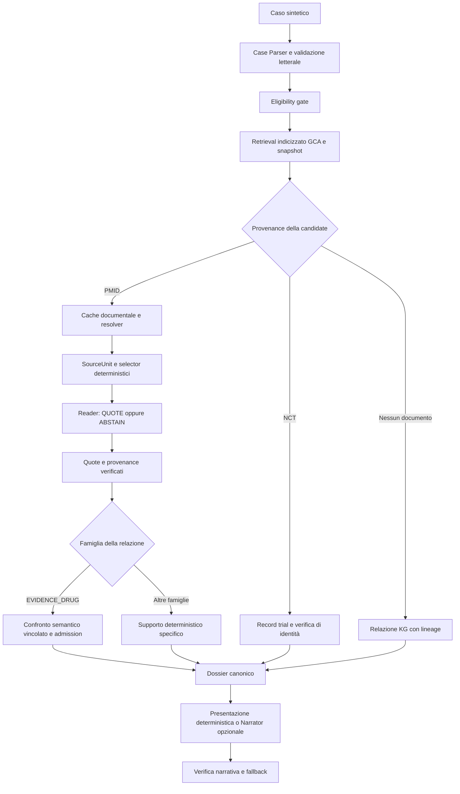

# Architettura corrente della tesi

Il runtime canonico è `backend/research_pipeline/orchestrator.py::run_case`,
eseguito da `run_store.py` attraverso `backend/api/research_routes.py`.
La console è `/research/verifiable-pipeline`. Il confronto deterministico/agentico
rimane un percorso storico distinto; `pipeline.py` è un harness di regressione
con provider esplicitamente iniettati.

## Flusso e confini

Il Parser usa `casecontext-parser-prompt/3.7`, il Reader
`paper-context-enricher-prompt/5.4` e il repository GCA `4.0`.
Questi numeri descrivono il codice corrente; gli artefatti registrati conservano
le proprie versioni e non sono reinterpretati come nuove esecuzioni.

## CaseContext e retrieval

Il parser mantiene separati malattia, gene, alterazione e fenotipo molecolare.
Un'indicazione di MSI senza grado conserva il valore letterale e richiede il
risultato completo prima del recupero; il controllo di sufficienza e
l'orchestratore applicano entrambi questo arresto. MSI-H viene riconosciuto
attraverso il profilo atomico documentato `CIViCProfile:5118`, collegato alla
variante senza gene `CIViCVariant:4944`. Il confronto richiede un'osservazione
positiva, risolta e con lo stesso valore del fenotipo. Una domanda ancorata
soltanto al fenotipo passa attraverso questa identità di profilo: il valore
non diventa un gene generico o un collegamento a trial arbitrari. MSI-L e MSS,
assenti dal dominio corrispondente del registro corrente, conservano l'esito
esplicito di ambito non supportato. dMMR resta distinto da MSI-H. Le traduzioni
approvate preservano la forma originale e le fonti dell'identità riconosciuta:
per esempio l'amplificazione viene risolta nel contesto del gene FGFR1.

Il target documentale conserva anche il fenotipo collegato alla fonte, verificando
profilo, componenti e provenienza della relazione. La corrispondenza del fenotipo
è un campo distinto dalla corrispondenza del gene. L'ambito della popolazione
conserva il passaggio letterale e distingue alternativa, intersezione e relazione
non determinabile: risultati su MSI-H oppure dMMR non stabiliscono automaticamente
un effetto del solo sottogruppo MSI-H. Questa identità non promuove il grado di
supporto della relazione; il frontend mostra separatamente corrispondenza e ambito.

La selezione identica può essere riutilizzata nella stessa esecuzione anche nel
percorso canonico, conservando la provenienza della relazione corrente. La
codifica MedCPT di un'unità lunga riprende dai blocchi già completati; un risultato
denso viene pubblicato soltanto dopo tutte le finestre. Le impronte dei pesi e
dei contenuti restano vincoli di integrità.

Per i dossier con contratto documentale il narratore ricopia esattamente il testo
di ambito del ramo. Il controllo del trasporto rileva anche errori nei nomi
contenuti in questo testo, prima della verifica finale della prosa. Il recupero
strutturale è limitato; le osservazioni scientifiche restano soggette ai
controlli documentali e narrativi già previsti.

La verifica narrativa comprende controlli circoscritti sulle affermazioni
attribuite alle singole osservazioni: specificità della variante, direzione
dell'effetto, composizione dell'intervento, efficacia causale ed eleggibilità
individuale. I dati del caso e della relazione cercata non autorizzano nuovi
risultati della fonte. Un'associazione predittiva non diventa una dimostrazione
di efficacia positiva o negativa. L'assenza di valutazione dell'eleggibilità
resta distinta da una conclusione di idoneità o inidoneità. Le negazioni sono
valutate nel loro contesto locale e le notazioni proteiche come `p.V600E`
rimangono nello stesso enunciato. Questi controlli deterministici proteggono i
vincoli implementati; non costituiscono una prova generale di equivalenza
semantica per qualsiasi parafrasi.

La versione 3.9 lega le dichiarazioni sui controlli al campo della stessa
osservazione: un gene confermato non equivale a una relazione confermata.
Quando il dossier registra un limite sulla popolazione, la narrazione conserva
il passaggio e il limite nella voce pertinente. Il controllo considera anche
negazioni locali che invertano il significato del limite obbligatorio.

### Profilo documentale sperimentale focused-v1

`RESEARCH_PIPELINE_DOCUMENTARY_PROFILE=focused-v1` abilita un percorso versionato
che mantiene distinti il target della GCA e gli interventi della domanda clinica
verificata. La pianificazione economica dei documenti precede il ranking neurale;
documenti duplicati o differiti conservano lineage e reason code. Il ranking
equivalente puo essere riusato entro la run, con hash di invocazione ricalcolato
per ogni candidate. Le GCA originali non sono riscritte.

In questo profilo i trial sono letti come fatti strutturati di registro, legati
allo snapshot NCT e verificati per ogni relazione, senza chiamate al Paper Reader.
I metadati di identita restano distinti dalle quote; efficacia ed eleggibilita
individuale non sono inferite. I testi completi delle SourceUnit rimangono privati
anche nei percorsi di errore.

I parser PubMed 1.1 e JATS 1.2 mantengono decimali e abbreviazioni nelle frasi.
Un sidecar collega frasi e paragrafi e celle al contesto di tabella. La selezione
gerarchica che restringe le unita indicizzate richiede un ulteriore opt-in,
`RESEARCH_PIPELINE_HIERARCHICAL_SOURCE_INDEX=1`; rimane disabilitata per default
perche modifica la copertura del retrieval. Il profilo focused mantiene quindi
l'intero inventario selezionabile.

I controlli `documentary-observation-checks/1.0` rilevano alcune incoerenze
esplicite dell'estrazione, incluse alternative molecolari rese come co-alterazioni,
farmaci di studi distinti resi come combinazione e obiettivi privi di risultati
resi come risposta. Non sono un classificatore generale di verita scientifica.

Nel profilo focused il budget di trasporto comprende anche retry e narratore.
Limiti opzionali: `RESEARCH_PIPELINE_MAX_LLM_CALLS_PER_RUN`,
`RESEARCH_PIPELINE_MAX_ESTIMATED_TOKENS_PER_RUN`,
`RESEARCH_PIPELINE_MAX_READER_SOURCE_CHARACTERS`,
`RESEARCH_PIPELINE_MAX_NEW_ENCODING_WINDOWS_PER_RUN` e
`RESEARCH_PIPELINE_MAX_ENCODING_SECONDS_PER_RUN`.
Il limite sui token usa una stima esplicitamente non certificata dal tokenizer,
comprensiva degli schemi tool; l'uso osservato resta separato e puo essere ignoto.
Il limite temporale locale si controlla prima dei batch, senza interrompere il
batch gia in corso. Il limite del testo Reader si applica anche a contesto
adiacente ed espansioni, mantenendo unita intere e lavoro differito esplicito.

Il profilo non e promosso automaticamente a default: test software e smoke live
sono documentati in `experiments_real/sourceunit_fix_evaluation/REPORT.md` dalla
radice del repository; la valutazione indipendente resta pendente.

La validazione verifica schema, riscontro letterale, negazioni, qualificatori e
ambiguità prima del retrieval. Le osservazioni molecolari tipizzate sono additive:
conservano i campi grezzi del Parser e rappresentano fusioni con partner ordinati,
span e identificatori supportati dal registro. Una fusione non diventa un gene
generico. Profili composti risolvono solo con corrispondenze esplicite;
forme sconosciute mantengono l'esito conservativo.

Il corpus composto e l'indice invertito sono caricati e verificati una volta per
processo. L'indice limita il lavoro sui geni identificati; anchor non risolti e
composti usano il percorso esaustivo. Ordinamento, aggregazione e candidate ammesse
mantengono le stesse regole. I motivi diagnostici delle esclusioni indicizzate
possono essere meno specifici del confronto esaustivo.

`retrieval_summary.corpus_snapshot` registra versione, hash e percorsi relativi
degli asset, registro terminologico, overlay e sorgenti upstream.
La provenance dei record trial è conservata separatamente nel loro contesto.
Il cap per famiglia e la configurazione dei documenti sono parte dell'audit.

## Tre rami della provenance

- `PAPER_EVIDENCE`: il documento originale è risolto cache-first, con full text
  PMC quando disponibile e abstract PubMed come alternativa. Le SourceUnit
  preservano identificatori, locatori e digest. Documento indisponibile e
  astensione rimangono esiti espliciti, senza inferenza di supporto.
- `CLINICAL_TRIAL`: il record NCT alimenta metadata e controlli di identità.
  L'associazione non dimostra efficacia; l'eleggibilità individuale resta
  `NOT_EVALUATED`. Questo ramo non usa il Paper Reader.
- `KG_ONLY`: il dossier conserva assertion e lineage grafica senza chiamare
  resolver, Reader o verifier documentale. Lo stato non attribuisce prova primaria.

Provenance incoerente, inclusa la presenza simultanea di PMID e NCT quando il
classificatore non la ammette, produce una limitation verificabile.

La cache dei PMID rivaluta dopo un'ora i soli fallimenti transitori documentati
senza contenuti o metadati e con timestamp valido, quando la rete è abilitata.
La rivalutazione aggiunge una nuova registrazione collegata all'impronta della
precedente. Cache positiva, errori permanenti e modalità offline mantengono il
comportamento precedente; recuperare una fonte non le attribuisce supporto.

## Policy di verifica documentale

`enrichment/verification_policy.py` dichiara le policy per famiglia. Il risultato
misura `SOURCE_RELATION_SUPPORT`; l'applicabilità clinica è `NOT_EVALUATED`.

Per `EVIDENCE_DRUG` la catena richiede quote letterale e autorizzata, identità degli
argomenti, assertion diretta, risultato osservato, scope molecolare e popolazione
comparabili, intervento esatto, inferenza diretta e assertion consolidata.
Il confronto semantico usa `evidence-drug-semantic-alignment/2.0`; la decisione
finale è calcolata dal contratto di admission, senza adottare un verdetto libero
come decisione clinica.

Le altre famiglie applicano `paper-relation-verifier/5.2`: richiedono campi centrali
pertinenti e assenza di contraddizioni nelle dimensioni obbligatorie. Malattia e
contesto di evidenza diventano obbligatori quando lo prevede il contratto della
candidate. Contesto obbligatorio mancante impedisce `FULL_SUPPORT`.

Il contesto integrale resta disponibile internamente fino alla costruzione e alla
riverifica del dossier. Solo la proiezione pubblica rimuove `required_context` e
l'evidence statement dal trace, conservando excerpt, locatori, digest e lunghezza.
La cache documentale autorizzata resta necessaria per riesaminare la fonte.
I digest del trace non sostituiscono la disponibilità del documento.

## Selezione del contesto e costi

Il selector passa per default fino a cinque SourceUnit al Reader. L'opzione
`RESEARCH_PIPELINE_EXPAND_READER_CONTEXT=1` abilita al massimo un secondo tentativo,
solo dopo trasporto valido e astensione per evidenza/relazione/anchor insufficienti.
Il secondo tentativo resta nello stesso documento, conserva le unità iniziali e
arriva per default fino a dieci unità. Ambiguità reale e quote/trasporto invalidi
non avviano un tentativo di riparazione.

`RESEARCH_PIPELINE_SOURCEUNIT_TOP_K` e
`RESEARCH_PIPELINE_EXPANDED_SOURCEUNIT_TOP_K` richiedono `1 <= iniziale <= espanso <= 20`.
Tentativi, SourceUnit, consumo osservato e motivo della mancata espansione sono
tracciati. Questa opzione è disabilitata per default e richiede una valutazione
separata del rapporto fra recupero e costo.

`budget.py` contiene l'unico budget condiviso, ri-esportato dal vecchio harness.
Un limite operativo esplicito resta fisso; il default viene dimensionato sul
numero finito di candidate, documenti, verifiche e tentativi autorizzati.

## Dossier e narrativa

Il JSON canonico contiene `run_status`, `case_summary`, `retrieval_summary`,
`paper_evidence`, `clinical_trials`, `kg_only_relations`, `limitations` e
`provenance_summary`. La presentazione deriva dal dossier già deciso.
`narrative/stage_runner.py` esegue il Narrator solo con opt-in esplicito
`RESEARCH_NARRATOR_ENABLED=1`; un output respinto torna alla narrativa
deterministica verificata o alla vista strutturata. La narrativa non cambia
support level, candidate o esito della run.

## Persistenza, API e moduli

| Responsabilità | Modulo |
|---|---|
| Coordinamento delle fasi | `orchestrator.py` |
| Registrazione pubblica durevole | `recording.py` |
| Budget delle chiamate | `budget.py` |
| Ammissione, worker e gestione errori | `run_store.py` |
| Letture SQLite paginate | `ledger_reads.py` |
| Ricostruzione dal ledger | `rehydration.py` |
| Schemi pubblici API | `public_schemas.py` |
| Generazione tipi e validator TypeScript | `scripts/generate_research_contracts.py` |
| Narrativa e verifica finale | `narrative/stage_runner.py` |
| Valutazione indipendente | `evaluation/independent_review/` |

Il ledger SQLite append-only con catena hash è la fonte di verità. Ogni evento
terminale di stage conserva la preview pubblica completa anche quando non esiste
un evento di dominio. La reidratazione usa quell'artefatto e mantiene il fallback
verificato; telemetry successiva non può sostituirlo. L'ammissione viene scritta
prima di cache/provider; gli abort imprevisti conservano un errore sanitizzato.
L'identità dell'input usa SHA-256 del testo completo, oltre alla preview.

Il pool limita worker e coda; l'elenco run e gli eventi usano paginazione SQLite.
La cache mantiene fino a cento run concluse (`RESEARCH_PIPELINE_MAX_CACHED_RUNS`),
oltre alle run attive; le altre restano accessibili tramite il ledger. Il testo
di un caso libero ha un limite API di 100.000 caratteri.
Lo stream SSE legge solo pagine successive al cursore. La verifica della catena
resta distinta dalla lettura di una pagina e dal giudizio sul contenuto scientifico.
L'audit di integrità REST verifica tutte le righe con memoria limitata a una riga;
il suo costo CPU resta lineare nel numero di eventi. Il ledger sigillato conserva
la propria implementazione e i preimage originali.
Gli schemi Pydantic e i contratti TypeScript generati condividono stati e struttura,
conservando i campi estensibili del trace. I consumer validano REST e SSE.

## Valutazione e limiti

Le regressioni offline verificano equivalenza del retrieval, admission,
provenance, persistenza e contratti; non misurano efficacia clinica.
[Il workflow di revisione indipendente](independent_review_workflow.md) prepara
pacchetti ciechi, tiene separate predizioni e label e calcola metriche solo su
item adjudicati. Il gold vuoto mantiene lo stato `PENDING`.

Restano dipendenze dalla copertura del corpus e dalla disponibilità dei documenti,
errori possibili nei modelli e la necessità di annotazione indipendente.
Il corpus è una release fissata: gli hash ne identificano il contenuto, senza
dimostrare che le fonti siano aggiornate o prive di ritrattazioni. Gli aggiornamenti
richiedono una nuova materializzazione/versione verificata e una nuova valutazione;
gli artefatti storici conservano gli hash originali. Le date di acquisizione dei
documenti restano nella provenance quando disponibili. Non è implementato uno
screening automatico delle ritrattazioni; il protocollo umano deve registrarlo
prima di interpretare il supporto della fonte.
Il runtime usa un solo processo proprietario del pool: limiti e stato di esecuzione
non costituiscono un coordinatore distribuito tra più server.
