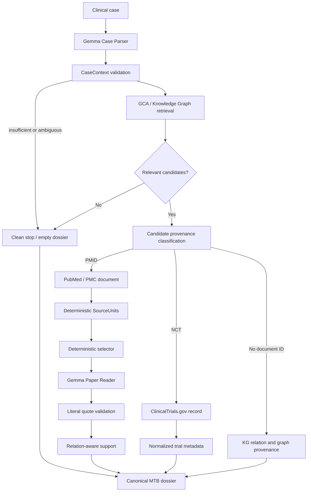

# Architettura finale — MTB KG-grounded evidence reporting

## 1. Problema

Un caso discusso in un Molecular Tumor Board può coinvolgere malattia, biomarcatori, varianti e trattamenti. Le basi di conoscenza oncologiche collegano questi elementi con relazioni eterogenee, ma una relazione del grafo non equivale automaticamente a evidenza documentale verificata. Il sistema deve quindi preservare sia il significato della relazione sia il limite della sua provenance.

## 2. Obiettivo

La pipeline trasforma un caso clinico in un dossier MTB strutturato e tracciabile. Il Knowledge Graph propone le relazioni pertinenti; la provenance di ogni relazione stabilisce il trattamento successivo: verifica di un paper, acquisizione di un record di trial oppure conservazione trasparente della sola relazione grafica. Il dossier non prescrive terapie.

## 3. Flusso canonico

## 4. Input e Case Parser

Il primo LLM riceve esclusivamente il testo clinico e produce un `CaseContext` JSON: malattia, biomarcatori, alterazioni, terapie menzionate, intervento oggetto della domanda, intento e ambiguità. Il prompt canonico è `casecontext-parser-prompt/3.0`. Impone estrazione letterale, vieta il completamento con conoscenza esterna e mantiene distinta una variante specifica dal gene generico.

La validazione successiva è deterministica. Verifica schema e riscontro nel testo, richiede un contesto di malattia e almeno un anchor molecolare o terapeutico. Un contesto insufficiente produce `INSUFFICIENT_CASE_CONTEXT`; un’ambiguità bloccante produce `NEEDS_CLARIFICATION`. In entrambi i casi il retrieval non viene eseguito.

## 5. Knowledge Graph e retrieval GCA

Il runtime non interroga live il grafo originale: usa 46.864 Graph Candidate Assertions (GCA 2.0) già materializzate. Ogni GCA conserva soggetto, predicato, oggetto, contesto, identificatori documentali e lineage grafica. Il retrieval confronta con il `CaseContext` i campi effettivamente disponibili nella relazione — disease, gene/alteration e intervento — senza imporre a tutte le famiglie lo stesso schema.

Le candidate sono ordinate deterministicamente e limitate da un cap configurabile per famiglia, registrato nel `retrieval_summary`. Se non esiste alcuna relazione pertinente, la pipeline restituisce `NO_RELEVANT_KG_EVIDENCE`, sezioni vuote e una limitation; non è un errore runtime.

## 6. Classificazione source-aware

Una sola funzione classifica la provenance:

- PMID senza NCT → `PAPER_EVIDENCE`;
- NCT senza PMID → `CLINICAL_TRIAL`;
- nessuno dei due → `KG_ONLY`;
- PMID e NCT insieme → `INVALID_PROVENANCE`, candidate non processata e limitation esplicita.

La classificazione avviene prima di qualunque elaborazione documentale. I tre rami restano separati.

## 7. Paper evidence

Il PMID originario della GCA viene risolto con policy cache-first. Quando disponibile e parsabile, il full text PMC è il documento canonico; altrimenti viene usato l’abstract PubMed. Se nessuno è disponibile, la candidate rimane nel dossier come `DOCUMENT_UNAVAILABLE` e `UNVERIFIABLE`.

Il parser documentale produce SourceUnit deterministiche, stabili e collegate al documento. Un selector deterministico riduce il testo passato al secondo LLM senza decidere il supporto. Il Reader usa `paper-context-enricher-prompt/3.0`, vede solo candidate e SourceUnit selezionate e restituisce `QUOTE` o `ABSTAIN`, una citazione letterale e le entità/direzioni osservate. Non produce support level né raccomandazioni.

Il Quote Validator controlla SourceUnit ID, presenza letterale della citazione e coerenza della provenance. Una quote invalida non viene riparata da un altro LLM: il risultato è `UNVERIFIABLE`.

La verifica relation-aware confronta deterministicamente i campi necessari per quella specifica relazione. Per relazioni terapeutiche controlla, quando presenti, disease, gene, alteration, drug, direction ed evidence type. Per relazioni diagnostiche, prognostiche, predisponenti, funzionali o oncogeniche non richiede un farmaco inesistente. Gli stati di campo sono `CONFIRMED`, `NOT_CONFIRMED`, `CONTRADICTORY`, `NOT_APPLICABLE`, `UNKNOWN`; l’esito complessivo è `FULL_SUPPORT`, `PARTIAL_SUPPORT`, `NO_SUPPORT`, `CONTRADICTORY` o `UNVERIFIABLE`.

## 8. Clinical trials

Una GCA con NCT viene risolta tramite ClinicalTrials.gov e proiettata in un record con titolo, stato, fase, condizioni e interventi. Gene/biomarker e relazione restano quelli della GCA. Il ramo trial non crea SourceUnit, non chiama il Paper Reader e non usa il paper support checker.

Ogni entry dichiara `TRIAL_ASSOCIATION_NOT_EFFICACY_EVIDENCE` e `eligibility_status=NOT_EVALUATED`. Se il record non è disponibile, NCT e provenance GCA restano visibili con `trial_resolution_status=UNAVAILABLE`.

## 9. KG-only

Una candidate priva di PMID/NCT entra direttamente nel dossier. Conserva relazione, contesto, database sorgente, regola di materializzazione, node IDs, edge IDs e graph path. Espone `verification_status=KG_ONLY` e `document_provenance=NOT_AVAILABLE`.

Questo stato significa che la relazione è presente nel KG ma non dispone, nella GCA corrente, di una fonte primaria utilizzabile dalla pipeline. Non significa né conferma clinica né falsità. Il ramo non chiama resolver, SourceUnit, Reader o Quote Validator.

## 10. Dossier canonico

L’output primario dell’API è un JSON deterministico con:

- `run_status`;
- `case_summary`;
- `retrieval_summary`;
- `paper_evidence[]`;
- `clinical_trials[]`;
- `kg_only_relations[]`;
- `limitations[]`;
- `provenance_summary`.

Il dossier storico resta disponibile come `legacy_dossier` per compatibilità, ma non definisce l’architettura scientifica. La UI principale visualizza le tre sezioni canoniche. Writer e Narrative Verifier rimangono codice opzionale/legacy, disabilitato nel normale runtime e irrilevante per retrieval, support e run status.

## 11. Provenance

- Paper: caso → candidate ID → lineage GCA → PMID/PMCID → documento → SourceUnit → quote → support → dossier.
- Trial: caso → candidate ID → lineage GCA → NCT → record normalizzato → dossier.
- KG-only: caso → candidate ID → lineage GCA → dossier.

Non è introdotto un ledger parallelo: vengono riusati gli identificatori già presenti.

## 12. Ruolo degli LLM

Il core usa al massimo due ruoli LLM:

1. Case Parser: testo clinico → struttura esplicita.
2. Paper Reader: SourceUnit selezionate → osservazioni e quote letterale.

Una run KG-only o trial-only richiede solo il Parser. Una run paper richiede il Parser e un Reader per ciascun paper processato. Tutto il resto è retrieval strutturato, risoluzione esterna o controllo deterministico. Writer: zero chiamate nel core.

## 13. Cosa il sistema non fa

Il sistema non decide una terapia, non sostituisce il MTB, non dimostra efficacia, non dichiara automaticamente l’eleggibilità a un trial, non considera il KG verità documentale e non cerca fonti alternative per relazioni KG-only. Il dossier rende visibile ciò che è disponibile e il grado con cui una fonte specifica sostiene una relazione specifica.

## 14. Limitazioni

- La copertura dipende dalle GCA materializzate e dal cap di retrieval configurato.
- La qualità del `CaseContext` dipende dall’estrazione del Parser, pur con validazione letterale.
- L’accesso a PubMed, PMC e ClinicalTrials.gov può essere incompleto o temporaneamente indisponibile.
- Il selector può omettere un passaggio rilevante dal contesto mostrato al Reader.
- Il supporto documentale è una verifica rispetto alla fonte associata, non una validazione clinica globale della relazione.
